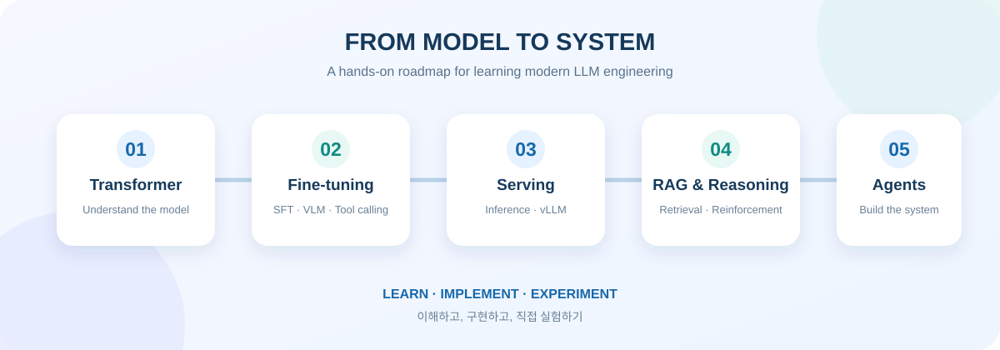
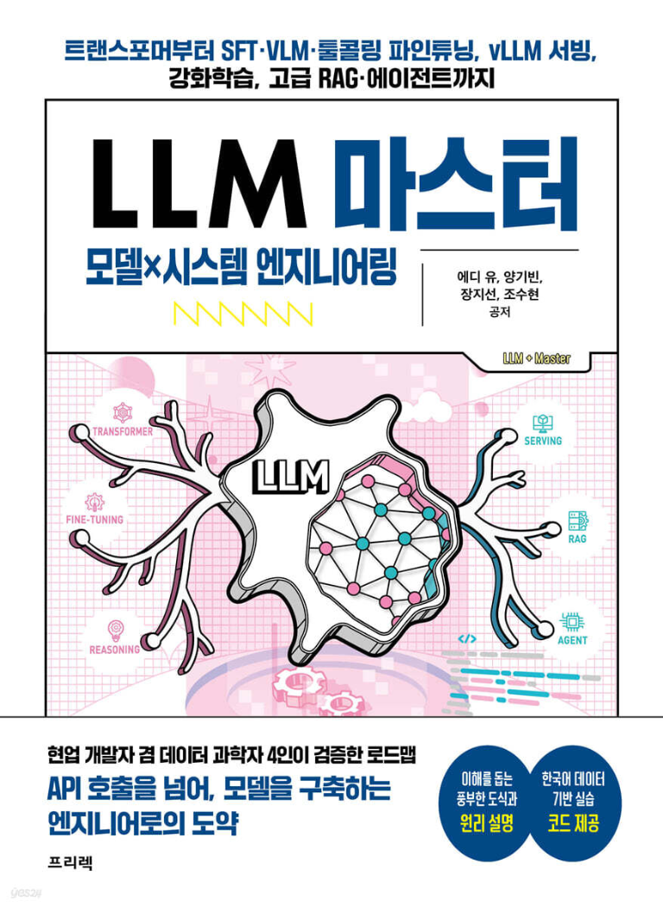

# LLM_Model_and_System_Engineering

> **모델을 이해하고, 시스템을 직접 만들며 배우는 LLM 엔지니어링 실험실**<br>
> *A hands-on lab for understanding LLMs and building the systems around them.*



## 프로젝트 소개 | About

### 한국어

저는 아직 뛰어난 실력자라고 말하기 어렵지만, 한국어로 된 *LLM 마스터: 모델×시스템 엔지니어링*이 출간되었다는 사실이 무척 반갑습니다. 트랜스포머의 기초에서 출발해 SFT·VLM·툴콜링 파인튜닝, vLLM 서빙, 강화학습, 고급 RAG와 에이전트까지 최신 LLM 기술을 차근차근 쌓아 가는 구성이 특히 유익하게 다가왔습니다.

이 저장소는 책과 공개 코드를 길잡이 삼아, 코드를 직접 실행하고 변형하면서 기능을 구현해 보는 학습 기록입니다. 각 구성 요소가 어떻게 연결되는지 살펴보고, LLM 서빙 시스템의 전반적인 흐름을 이해하기 쉽게 정리해 가는 것을 목표로 합니다.

### English

I am still learning and would not call myself an expert, so I am especially glad to see a Korean book dedicated to LLM model and systems engineering. Its gradual path—from transformer fundamentals through SFT, VLMs, tool-calling fine-tuning, vLLM serving, reinforcement learning, advanced RAG, and agents—offers a helpful way to build up knowledge of current LLM technologies.

This repository is my learning log as I work through the book and its public code examples. I run and adapt the examples, implement features, and experiment with how the pieces fit together. The goal is to make the overall shape of LLM serving easier to understand through hands-on practice.

## 참고 도서 및 코드 | Book & Code

- **도서 | Book:** *LLM 마스터: 모델×시스템 엔지니어링*
- **저자 | Authors:** 에디 유, 양기빈, 장지선, 조수현
- **출판사 | Publisher:** 프리렉
- **출간일 | Published:** 2026-09-28

<p align="center">
  
</p>

- **공개 예제 코드 | Public example code:** [freelec-llm-scientist/freelec_llm_scientist_code](https://github.com/freelec-llm-scientist/freelec_llm_scientist_code)
- **함께 살펴보는 노트북 | Notebook reference:** [Chapter 2: Transformer](https://github.com/freelec-llm-scientist/freelec_llm_scientist_code/blob/main/chapter_02/chapter02_1_transformer.ipynb)

이 프로젝트는 학습과 실험을 위한 개인 저장소이며, 도서의 저자·출판사 또는 원본 코드 저장소와 공식적으로 제휴하거나 이를 대표하지 않습니다.<br>
This is an independent learning project and is not affiliated with or endorsed by the book's authors, publisher, or the source-code repository.

## 학습 로드맵 | Learning Roadmap

| 주제 | Topics |
| --- | --- |
| 트랜스포머 | Transformer fundamentals |
| 파인튜닝 | Fine-tuning: SFT, VLM, and tool calling |
| 모델 서빙 | Model serving with vLLM |
| 추론과 강화학습 | Reasoning and reinforcement learning |
| 검색 증강 생성 | Advanced retrieval-augmented generation (RAG) |
| 에이전트 | LLM agents |

## 실행 환경 기준 | Runtime Environment

책의 예제는 2장은 Google Colab, 3장 이후는 RunPod 클라우드 GPU를 기준으로 환경을 설정합니다. 이 저장소는 클라우드 GPU를 쓰지 않고, **모든 예제를 로컬 NVIDIA GPU(CUDA)에서 실행하는 것**을 기준으로 합니다.

The book sets up Chapter 2 on Google Colab and Chapter 3 onward on RunPod cloud GPUs. This repository uses no cloud GPUs: every example runs on a local NVIDIA GPU with CUDA.

| 구분 | 책 기준 · Book | 이 저장소 · This repository |
| --- | --- | --- |
| 2장 · Chapter 2 | Google Colab (T4 GPU) | 로컬 CUDA GPU · Local CUDA GPU |
| 3장 이후 · Chapter 3+ | RunPod 클라우드 GPU · RunPod cloud GPU | 로컬 CUDA GPU · Local CUDA GPU |
| GPU | Colab T4 (16GB) 등 · and others | NVIDIA GeForce RTX 5060 Laptop GPU (8GB, Blackwell sm_120) |
| 패키지 설치 · Install | 노트북 셀의 `!pip install` | `uv sync` ([pyproject.toml](pyproject.toml), [uv.lock](uv.lock)) |
| 3장 실행 OS · Chapter 3 OS | RunPod (Linux) | WSL2 Ubuntu (같은 로컬 GPU) · WSL2 Ubuntu on the same GPU |

GPU 연산이 없는 코드(02_01·02_02의 순수 Python 구현, 02_03의 토크나이저)는 그대로 실행하고, 모델을 GPU에 올리는 코드는 02_04부터입니다. 3장은 WSL2 Ubuntu에서 실행합니다. 평가에 쓰는 vllm이 Linux에서만 동작하고, Windows용 PyTorch에는 FlashAttention이 없어 긴 시퀀스 학습에서 메모리가 크게 늘기 때문입니다([아래 참고](#wsl2-ubuntu에서-실행--running-on-wsl2-ubuntu)). 책의 예제가 8GB보다 큰 GPU 메모리를 전제로 하면, 로컬에 맞춰 조정한 내용을 이 README와 해당 코드에 기록합니다.

Code without GPU work (pure Python in 02_01 and 02_02, the tokenizer in 02_03) runs as is; loading models onto the GPU starts at 02_04. Chapter 3 runs in WSL2 Ubuntu, because vLLM is Linux-only and the Windows PyTorch build lacks FlashAttention, which makes long-sequence training use far more memory. If an example assumes more than 8GB of GPU memory, the local adjustments are recorded here and in the code.

## 코드 변경 원칙 | Code Conventions

- 책 코드를 바꾼 줄은 원래 코드를 주석으로 남기고, 바로 아래에 바꾼 코드를 적습니다.
- GPU를 쓰는 파일은 `_00` 섹션(예: `02_04_00`)에서 모델을 불러오기 전에 GPU를 점검합니다. CUDA 빌드와 사용 가능 여부, GPU 이름과 아키텍처, VRAM, 라이브러리 버전을 출력하고, CUDA를 쓸 수 없으면 `assert`로 멈춥니다.
- 모델을 불러온 뒤에는 모든 파라미터가 GPU에 있는지와 양자화가 적용됐는지 확인합니다. 추론에서는 생성 속도와 최대 GPU 메모리를 출력합니다.
- 실행 결과는 출력 코드 아래에 주석으로 남깁니다. 실행 환경이나 변경 이유처럼 README에 정리한 내용은 코드 주석에 반복하지 않습니다.

Changed lines from the book keep the original as a comment directly above the new line. Files that use the GPU start with a `_00` section that checks the GPU before loading a model, and they verify device placement, quantization, generation speed, and peak GPU memory. Anything documented in this README is not repeated in code comments.

```python
model = AutoModelForCausalLM.from_pretrained(
    model_id,
    # device_map="auto",
    device_map=device,
    quantization_config=bnb_config
)
```

### `device_map="auto"` → `device_map="cuda:0"`

책은 `device_map="auto"`를 사용합니다. 이 방식은 남은 메모리를 보고 모델을 놓을 장치를 스스로 정합니다. GPU 한 장을 쓰는 로컬에서는 `_00` 섹션에서 정한 `device = "cuda:0"`으로 장치를 직접 지정합니다. 그러면 모델이 GPU에 올라가지 못할 때 바로 알 수 있습니다.

The book uses `device_map="auto"`, which picks devices from available memory. Locally, with a single GPU, the device is set explicitly to `cuda:0` so that a failure to load onto the GPU surfaces immediately.

| 상황 · Situation | `"auto"` | `"cuda:0"` |
| --- | --- | --- |
| GPU를 찾지 못함 (CPU용 PyTorch 등) · No GPU found | 오류 없이 모델 전체를 CPU에 올려 매우 느려짐 · Silently loads on CPU | 바로 오류 · Fails immediately |
| GPU 메모리 부족 · Not enough VRAM | 일부 층을 CPU에 두려다 4비트 모델이라 `ValueError`, 원인 파악이 어려움 · Unclear `ValueError` about CPU offload | 메모리 부족(OOM) 오류로 원인이 분명함 · Clear out-of-memory error |

## 8GB 조정: 3장 SFT | 8GB Adjustments for Chapter 3 SFT

책의 3장 학습은 RunPod의 80GB GPU를 기준으로 합니다. 그대로 실행하면 8GB VRAM을 크게 넘고, Windows 드라이버가 부족한 VRAM을 시스템 RAM으로 메우면서(Sysmem Fallback) 컴퓨터가 멈출 수 있습니다. 메모리를 가장 많이 쓰는 부분은 손실 계산에 쓰이는 logits입니다. logits는 모든 위치에서 어휘 151,936개의 점수를 계산한 값으로, 토큰 하나당 약 1.5MB를 차지합니다. 실제로 학습하는 정답은 전체 토큰의 약 7.7%뿐입니다.

The book's Chapter 3 training assumes an 80GB RunPod GPU. Run as is, it far exceeds 8GB of VRAM, and the Windows driver's sysmem fallback can freeze the machine. Most of the memory goes to the logits (151,936 vocabulary scores at every position, about 1.5MB per token), even though only about 7.7% of the tokens are trained on.

| 항목 · Item | 책 · Book | 이 저장소 · This repository | 이유 · Reason |
| --- | --- | --- | --- |
| 모델 로드 (03) | dtype 미지정 → float32 (6.9GB) | `torch_dtype=torch.bfloat16` (3.4GB) | `bf16=True` 학습과 일치, 가중치 메모리 절반 |
| 배치 (07) | 배치 2, 누적 2 | 배치 1, 누적 4 | 유효 배치 4는 같음. 긴 샘플에 맞춘 패딩이 사라짐 |
| 손실 계산 (07) | 전체 길이의 logits | `AnswerOnlyLossTrainer`: 정답 위치에서만 `lm_head` 계산 | 손실 값은 같고, logits 메모리는 정답 길이만큼만 사용 |
| VRAM 상한 (00) | 없음 | `torch.cuda.set_per_process_memory_fraction(0.85)` | 넘으면 RAM을 빌려 쓰지 않고 OOM 오류로 안전하게 멈춤 |
| 어텐션 (00·07) | FlashAttention (Linux) | WSL: `FLASH_ATTENTION` 고정 / Windows: GQA 경로를 끄고 `EFFICIENT_ATTENTION` | Windows PyTorch에는 FlashAttention이 없어 GQA 어텐션이 L×L 행렬(math 방식)로 계산되며 OOM |
| 사전 시험 (07) | 없음 | `TEST_RUN`: 가장 긴 샘플 8개로 2스텝 | 본 학습 전에 최대 메모리와 속도 확인 |
| 비교 모델 로드 (08) | 베이스·LoRA 모델 두 벌 (6.9GB) | 베이스 한 벌 + 어댑터, `disable_adapter()`로 베이스 출력 | 메모리 절반 |
| 생성 길이 (09) | `max_length=8192` | `max_new_tokens=1024` | 반복 생성 방지, 03_2 평가와 같은 기준 |
| RunPod 캐시 (01) | `/workspace` 캐시 지정 | 주석 처리 | 로컬은 기본 Hugging Face 캐시 사용 |
| vLLM 메모리 (03_02) | `gpu_memory_utilization` 기본 0.9 (80GB 중 71.3GiB) | `0.75` (5.97GiB) | 0.9(7.2GB)는 Windows가 쓰는 VRAM 때문에 시작 단계에서 실패. KV 캐시 1.29GiB = 12,080토큰, 동시 처리 1.47개 |

**결과 (RTX 5060 Laptop 8GB, WSL2):**
- **사전 시험:** 가장 긴 샘플(6,885토큰) 기준 최대 GPU 메모리 4.84GB, 스텝당 8.9초
- **본 학습:** 735스텝을 1,772초(약 29.5분) 동안 학습
- **loss:** 0.169(100스텝) → 0.059(600스텝), 전체 평균 0.076
- **정답 토큰 정확도:** 97.0% → 98.2%

**Results (RTX 5060 Laptop 8GB, WSL2):** a dry run on the longest samples (6,885 tokens) peaked at 4.84GB at 8.9 s/step. Full training ran 735 steps in 1,772 s (about 29.5 minutes). Loss went from 0.169 at step 100 to 0.059 at step 600 (average 0.076), and answer-token accuracy went from 97.0% to 98.2%.

## 로컬 CUDA 설정 및 실행 | Local CUDA Setup

이 프로젝트는 Python 3.12와 [uv](https://docs.astral.sh/uv/)를 사용하는 독립 프로젝트입니다. `uv sync`를 실행하면 저장소 안에 `.venv`가 만들어집니다. 직접 의존성은 [pyproject.toml](pyproject.toml)에, 재현 가능한 전체 의존성 버전은 [uv.lock](uv.lock)에 기록합니다. 소스 파일은 주제별 폴더로 옮기지 않고 저장소 루트에 둡니다.

This is a standalone project using Python 3.12 and [uv](https://docs.astral.sh/uv/); `uv sync` creates `.venv` inside the repository. Direct dependencies are declared in [pyproject.toml](pyproject.toml), with resolved versions recorded in [uv.lock](uv.lock). Source files stay in the repository root rather than being split into topic folders.

| 패키지 · Package | 버전 · Version | 책 기준 · Book | 용도 · Purpose |
| --- | --- | --- | --- |
| `torch` · `torchaudio` · `torchvision` | 2.8.0 · 2.8.0 · 0.23.0 (CUDA 12.8) | 3장과 같음 (2장은 Colab 기본값) | GPU 텐서 연산 · GPU tensor backend |
| `transformers` | 4.55.2 | 2장 4.55.0, 3장 4.53.0 | 토크나이저·모델 로드·추론·학습 · Tokenizers, models, inference, training |
| `accelerate` | 1.8.1 | 같음 | 모델을 장치에 올리기와 학습 실행 · Device placement and training |
| `bitsandbytes` | 0.46.0 | 같음 | 8비트·4비트 양자화 로드 · 8-bit and 4-bit quantized loading |
| `trl` | 0.19.0 | 같음 | `SFTTrainer`로 지도 미세조정 · Supervised fine-tuning |
| `peft` | 0.10.0 | 같음 | LoRA 어댑터 적용·병합 · LoRA adapters |
| `datasets` | 5.0.1 | 버전 미지정 | 학습 데이터셋 구성과 토큰화 · Dataset building |
| `hf-transfer` | 0.1.9 | 버전 미지정 | Hugging Face 고속 다운로드, `HF_HUB_ENABLE_HF_TRANSFER=1`일 때만 사용 · Faster Hub downloads when `HF_HUB_ENABLE_HF_TRANSFER=1` |
| `pandas` | 3.0.6 | 미설치 (RunPod 기본 포함) | 뉴스 데이터 불러오기와 평가 표 · Data loading and result tables |
| `python-mecab-ko` | 1.3.7 | 버전 미지정 | 한국어 형태소 분석 (ROUGE 계산용) · Korean morphological analysis |
| `rouge` | 1.0.1 | 버전 미지정 | ROUGE-1/2/L 점수 · ROUGE scores |
| `vllm` | 0.10.2 (Linux 전용) | 같음 | 평가셋 일괄 생성과 LoRA 서빙 · Batched generation with LoRA |

의존성을 추가할 때는 `pip install` 대신 `uv add 패키지==버전`을 사용합니다. 그러면 `pyproject.toml`과 `uv.lock`이 함께 갱신됩니다.

**버전을 이렇게 맞춘 이유**
- **torch 2.8.0 (CUDA 12.8):** 책 3장이 지정한 버전이고, vllm 0.10.2가 torch·torchaudio·torchvision 버전을 정확히 요구합니다. CUDA 12.8 빌드라서 RTX 50 시리즈(Blackwell, CUDA 12.8 이상 필요)와 `bitsandbytes 0.46.0`(CUDA 12.8까지 지원)의 조건도 함께 만족합니다. 2장은 torch 버전을 지정하지 않으므로 같은 버전을 씁니다. PyTorch는 PyPI가 아니라 [CUDA 12.8용 저장소](https://download.pytorch.org/whl/cu128)에서 받습니다.
- **transformers 4.55.2:** 책은 2장에서 4.55.0, 3장 학습에서 4.53.0을 쓰지만, vllm 0.10.2는 4.55.2 이상을 요구합니다. 한 환경에서 모든 장을 실행하기 위해 vllm 조건을 만족하는 가장 낮은 버전으로 통일했습니다. 2장과는 버그 수정(패치) 차이뿐이고, `trl 0.19.0`도 4.51 이상이면 동작합니다.
- **Python 3.12:** vllm 0.10.2가 Python 3.14를 지원하지 않고, 책의 RunPod 환경도 Python 3.12입니다.

Add dependencies with `uv add package==version` instead of `pip install` so both `pyproject.toml` and `uv.lock` are updated. torch 2.8.0 (CUDA 12.8) is the version the book uses in Chapter 3 and the exact version vLLM 0.10.2 requires; as a CUDA 12.8 build it also supports RTX 50-series GPUs and `bitsandbytes 0.46.0`. The book pins transformers 4.55.0 (Chapter 2) and 4.53.0 (Chapter 3 training), but vLLM 0.10.2 needs 4.55.2 or later, so every chapter uses 4.55.2. Python is limited to 3.12 because vLLM 0.10.2 does not support 3.14 and the book's RunPod image uses 3.12.

```powershell
# 저장소 폴더에서 실행
uv sync

# GPU 인식 확인 (True와 GPU 이름이 나와야 함)
uv run python -c "import torch; print(torch.cuda.is_available(), torch.cuda.get_device_name(0))"

# 채팅 토크나이저와 템플릿 확인
uv run python .\02_03_llm_chat_template.py

# 4비트 양자화 모델 로드와 GPU 추론
uv run python .\02_04_llm_inference.py
```

**02_03:** 처음 실행할 때 `openai/gpt-oss-20b` 토크나이저 파일을 Hugging Face에서 내려받으므로 인터넷 연결이 필요합니다. 모델 가중치는 내려받지 않습니다. 정상 실행 여부는 Transformers 버전이 `4.55.2`인지, 토큰 ID를 디코딩한 문장이 원문과 같은지, 채팅 템플릿이 어시스턴트 생성 위치까지 출력하는지, 마지막 결과가 PyTorch 텐서인지 확인하면 됩니다.

**02_03:** On first run, the script downloads tokenizer files for `openai/gpt-oss-20b` from Hugging Face, so an internet connection is required. It does not download model weights. To check the setup, confirm Transformers reports version `4.55.2`, decoding the token IDs reproduces the original text, the chat template ends at the assistant generation point, and the final output is a PyTorch tensor.

**02_04:** 처음 실행할 때 `Qwen/Qwen3-4B-Instruct-2507` 가중치(약 8GB)를 내려받습니다. 4비트로 불러오면 GPU 메모리를 약 2.5GB 사용합니다. 모든 파라미터가 `cuda:0`에 있고 `Linear4bit` 층이 252개이면 정상입니다.

**02_04:** On first run, the script downloads the `Qwen/Qwen3-4B-Instruct-2507` weights (about 8GB). Loaded in 4-bit, the model uses about 2.5GB of GPU memory. The setup is correct when every parameter is on `cuda:0` and there are 252 `Linear4bit` layers.

### WSL2 Ubuntu에서 실행 | Running on WSL2 Ubuntu

3장은 WSL2 Ubuntu에서 실행합니다. 이유는 두 가지입니다.
- **vllm:** Linux용 패키지만 있어서 Windows에서는 설치되지 않습니다(`sys_platform == 'linux'`일 때만 설치).
- **FlashAttention:** Linux용 PyTorch에는 들어 있습니다. PyTorch 2.8은 sm80~sm121을 지원하므로 RTX 5060(sm_120)에서 GQA와 함께 동작합니다.

WSL2는 Windows의 NVIDIA 드라이버로 같은 GPU를 쓰므로, Ubuntu 안에 드라이버를 따로 설치하지 않습니다. 코드는 Windows의 저장소 폴더에서 VS Code로 편집하고, Ubuntu에서는 그 폴더(`/mnt/c/...`)를 그대로 실행합니다. Linux용 가상환경은 Windows `.venv`와 섞이지 않도록 Ubuntu 홈 폴더에 따로 만듭니다. Hugging Face 캐시는 Windows 쪽을 함께 써서 모델을 다시 받지 않습니다.

Chapter 3 runs in WSL2 Ubuntu: vLLM ships Linux wheels only, and the Linux PyTorch build includes FlashAttention, which in PyTorch 2.8 supports sm80–sm121, so it runs with GQA on the RTX 5060 (sm_120). WSL2 uses the GPU through the Windows NVIDIA driver, so do not install a driver inside Ubuntu. Code is edited on Windows and run from the same folder (`/mnt/c/...`) in Ubuntu, with a separate Linux virtual environment in the Ubuntu home folder and the Windows Hugging Face cache shared to avoid re-downloads.

```powershell
# Windows PowerShell: Ubuntu 설치 (처음 한 번, Linux 사용자 이름과 비밀번호를 정함)
wsl --install -d Ubuntu-24.04
```

```bash
# Ubuntu 안에서 실행 (처음 한 번)
nvidia-smi                                   # Windows 드라이버로 GPU가 보이는지 확인
sudo apt update && sudo apt install -y git build-essential python3.12-dev   # Python.h: vLLM 시작 시 Triton C 확장 컴파일에 필요
curl -LsSf https://astral.sh/uv/install.sh | sh
source ~/.local/bin/env

# 작업용 명령 llm: 저장소 폴더로 이동하고 Linux 가상환경과 HF 캐시 위치를 지정
cat >> ~/.bashrc <<'EOF'
llm() {
  export UV_PROJECT_ENVIRONMENT="$HOME/.venvs/llm_serve"
  export HF_HOME="/mnt/c/Users/hrjeo/.cache/huggingface"
  cd /mnt/c/Users/hrjeo/llm_serve
}
EOF
source ~/.bashrc

llm
uv sync --locked                             # Linux에서는 vllm까지 설치됨
uv run python -c "import torch, vllm; print(vllm.__version__, torch.cuda.get_device_name(0), torch.backends.cuda.is_flash_attention_available())"
```

⚠️ Ubuntu에서 uv를 쓰기 전에는 **반드시 `llm`을 먼저 실행합니다.** 그러지 않으면 uv가 저장소의 Windows용 `.venv`를 건드립니다. `HF_HOME` 경로는 본인의 Windows 사용자 폴더에 맞게 바꿉니다.

⚠️ Always run `llm` before using uv in Ubuntu; otherwise uv touches the repository's Windows `.venv`. Adjust the `HF_HOME` path to your Windows user folder.

```bash
# 3장 학습 (03_01): TEST_RUN = True로 메모리·속도를 먼저 확인한 뒤 False로 본 학습
llm
uv run python 03_01_sllm_summary_finetuning.py
```

**Hugging Face 업로드:** 모델을 Hub에 올릴 때는 토큰을 코드에 쓰지 않고, 터미널에서 `uv run hf auth login`으로 한 번 로그인합니다. 토큰이 `HF_HOME`에 저장되어 코드에서 자동으로 쓰입니다. 이 저장소는 공개 저장소이므로 토큰이 커밋되면 그대로 노출됩니다. 토큰은 Write 권한으로 만듭니다.

**Hugging Face uploads:** never put the token in code. Log in once with `uv run hf auth login`; the token is stored under `HF_HOME` and picked up automatically. This repository is public, so a committed token would be exposed. Create the token with write permission.

## 저장소 구성 | Repository Contents

코드 파일은 폴더로 재배치하지 않고 저장소 루트에 순서대로 관리합니다.
Code files remain in the repository root and are organized by filename and section ID.

| 파일 | 내용 |
| --- | --- |
| [`01_Theories.md`](01_Theories.md) | 개념 및 학습 메모 · Concepts and notes |
| [`02_01_transformer.py`](02_01_transformer.py) | 자동 미분부터 트랜스포머 인코더-디코더의 학습과 추론까지 · Transformer fundamentals, training, and inference |
| [`02_02_transformer_model_BERT_and_GPT.py`](02_02_transformer_model_BERT_and_GPT.py) | BERT와 GPT 구조 비교 · BERT and GPT architecture |
| [`02_03_llm_chat_template.py`](02_03_llm_chat_template.py) | 토큰화와 채팅 템플릿 적용 · Tokenization and chat templates |
| [`02_04_llm_inference.py`](02_04_llm_inference.py) | GPU 점검, 4비트 양자화 모델 로드와 추론 · GPU checks, 4-bit model loading, and inference |
| [`03_01_sllm_summary_finetuning.py`](03_01_sllm_summary_finetuning.py) | 뉴스 이벤트 추출 데이터로 Qwen3-1.7B LoRA SFT, 8GB 조정과 학습 전후 비교 · LoRA SFT of Qwen3-1.7B for news event extraction on 8GB |

## 실험 원칙 | How I Learn

- 코드를 직접 실행하고, 입력과 설정을 바꿔 결과를 비교합니다.
- 각 기능이 모델·데이터·서빙 시스템에서 맡는 역할을 기록합니다.
- 재현 가능한 코드와 이해하기 쉬운 설명을 함께 남깁니다.

---

*배우고, 구현하고, 실험하며 LLM 시스템의 전체 그림을 그려 갑니다.*<br>
*Learn, build, and experiment to see the bigger picture of LLM systems.*
